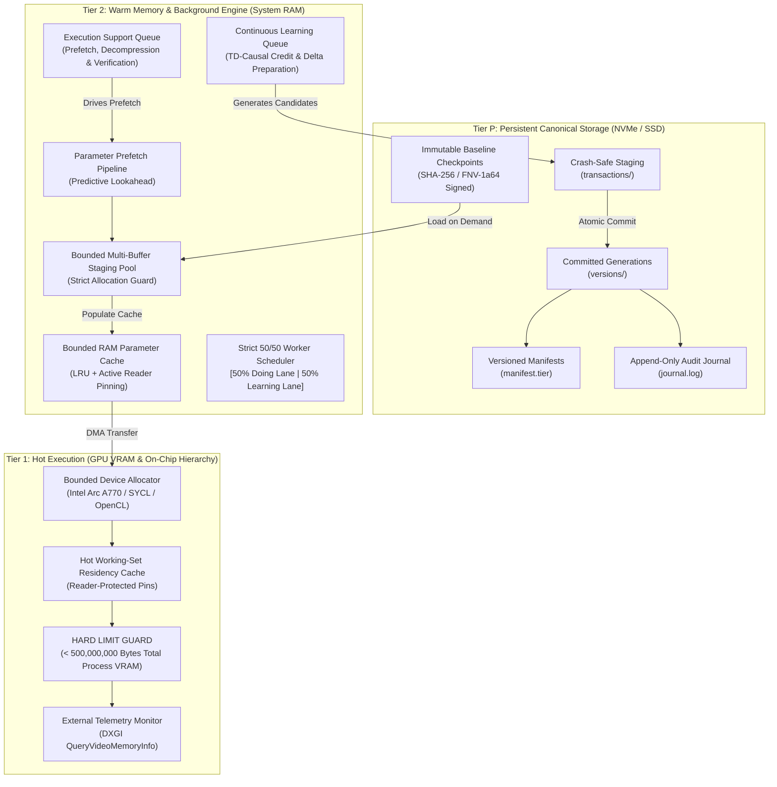

# PROJECT B — TRITIER: SYSTEM ARCHITECTURE SPECIFICATION
## A Persistent, GPU-Bounded, RAM-Managed, Continuously Learning Model Runtime

### 1. Architectural Overview & Design Philosophy

TriTier is a high-performance three-tier memory runtime engineered to execute and continuously learn on massive models (up to and exceeding 10 billion parameters) under strict physical hardware constraints.

The runtime enforces an absolute separation of authority and residency across three physical memory tiers:

---

### 2. Physical Memory Tiers

#### Tier P — Persistent Canonical Storage (NVMe/SSD)
- **Role:** Authoritative source of truth.
- **Invariants:**
  - **Baseline Immutability:** Baseline parameter blocks (`versions/baseline/blocks/*.bin`) are write-once, read-only. Newly learned parameters are never written over baseline files.
  - **Crash-Safe Transactions:** Updates are staged in isolated transaction workspaces (`transactions/<cand_id>-<timestamp>/`). A transaction is committed atomically via filesystem directory rename into `versions/<new_version>/` containing a signed manifest.
  - **Deterministic Addressing:** Every parameter block is identified by a `BlockKey { model_id, version, block_id }` with offset, byte size, parameter count, encoding format, and FNV-1a checksum.
  - **Self-Healing Recovery:** Any interrupted or uncommitted transaction is automatically detected, isolated, and discarded during `recover()` without corrupting active model state.

#### Tier 2 — Warm System RAM & Background Workers
- **Role:** Working cache, staging pipeline, and background compute engine.
- **Components:**
  - **RAM Parameter Cache (`RamCache`):** Bounded parameter cache enforcing reader pins. Eviction utilizes least-recently-used (LRU) policy over unpinned blocks.
  - **Staging Budget Manager (`StagingBudget`):** Independent buffer budget ensuring prefetchers cannot exhaust system RAM.
  - **Strict 50/50 Scheduler (`Tier2Scheduler`):** Schedulable capacity is divided into dedicated worker lanes:
    - **50% Doing / Execution Support:** Parameter prefetching, input batch preparation, block decompression, validation, telemetry recording.
    - **50% Continuous Learning:** Candidate update generation, eligibility trace evaluation, objective scoring, transactional delta preparation.
    - **Capacity Contract:** When both queues contain work, neither queue may starve or borrow capacity from the other. Borrowing occurs only when a lane has exhausted its own work.

#### Tier 1 — Hot GPU Working Set (VRAM & Cache)
- **Role:** Active computation kernel.
- **Components:**
  - **Bounded Allocator:** Native device allocation on the Intel(R) Arc(TM) A770 Graphics card via OpenCL / Level-Zero / SYCL.
  - **VRAM Hard Cap Enforcement:** Peak process-attributable GPU memory must remain strictly below **500,000,000 bytes** (< 500 MB) during sustained execution of the 10-billion-parameter benchmark.
  - **Dual Telemetry Verification:**
    1. *Internal Telemetry:* Exact tracking of all device buffers, staging areas, and workspaces.
    2. *External Telemetry:* Windows OS DXGI video memory query (`IDXGIAdapter3::QueryVideoMemoryInfo`) reporting real-time process VRAM utilization.
  - **Dynamic Pressure Handling:** When memory pressure approaches budget limits, tile sizes are automatically halved (down to `min_tile_bytes`), unpinned blocks are evicted, and computation chunks are downscaled.

---

### 3. Supercharged Learning & Credit Assignment Subsystem

The continuous learning engine operates directly on discrete ternary weights $\{-1, 0, +1\}$ without floating-point gradient descent or attention approximations.

#### 1. Multi-Step Temporal Eligibility Traces ($\text{TD}(\lambda)$)
Maintains an eligibility trace for each recurrent state dimension:
$$e_t = \gamma \lambda e_{t-1} + s_t$$
where $\gamma = 0.85$ is the temporal discount factor and $\lambda = 0.80$ is the trace decay parameter. When prediction error occurs at sequence step $T$, credit is back-propagated along the sequence trajectory, crediting earlier attractor states that enabled the correct output.

#### 2. Contrastive Margin-Deficit Credit Assignment
Rather than static unit increments, credit and suppression magnitudes scale with the decision margin deficit:
$$\text{margin\_deficit} = \max\left(0, \text{score}(\text{distractor}) - \text{score}(\text{target}) + \theta_{\text{margin}}\right)$$
$$\Delta_{\text{reinforce}} = \text{clamp}\left(\text{base} + \lfloor \text{margin\_deficit} \rfloor, 2, 8\right)$$
$$\Delta_{\text{suppress}} = \text{clamp}\left(\text{base} + \lfloor \text{margin\_deficit} \rfloor - \text{stability}, 1, 8\right)$$

#### 3. Full-Dimensional Causal Dimension Attribution
Eliminates arbitrary slicing (`[:6]`, `[:8]`, `[:4]`). All active state dimensions ($s_i \neq 0$) are evaluated for their causal contribution to the prediction and updated proportionally.

#### 4. Metaplasticity & Synaptic Consolidation
Tracks synaptic stability $\tau_{ij}$ across epochs:
$$\tau_{ij} \leftarrow \tau_{ij} + \Delta_{\text{stability}}$$
Synapses repeatedly confirmed by successful evaluations build resistance against spurious suppression, preventing catastrophic forgetting of foundational conversational knowledge.

#### 5. Working Memory Gate Plasticity ($W_{\text{gate}}$)
The memory gate dynamically learns when to clear context ($gate = -1$) upon boundary markers (`<sep>`) and when to retain context ($gate = 1$) during multi-step answer generation.

---

### 4. Multi-Language Interfaces

| Language | Layer | Role |
| :--- | :--- | :--- |
| **Rust** | Core Engine | Block identity, persistent storage, RAM cache, staging budget, 50/50 scheduler, transaction commits. |
| **C++ / OpenCL** | Native GPU Driver | Device allocation, Intel Arc A770 execution, DXGI VRAM telemetry queries. |
| **Python** | Model Integration | `LumenMAX` runtime adapter, dataset ingestion, Supercharged Credit Engine, benchmark harnesses. |
| **Julia** | Cognitive Reasoning | `TernaryCognitiveAI` adapter, hypothesis evaluation, candidate delta verification. |
| **C ABI** | Stable Boundary | Zero-copy FFI functions (`tt_runtime_open`, `tt_runtime_acquire`, `tt_runtime_telemetry`, etc.). |
